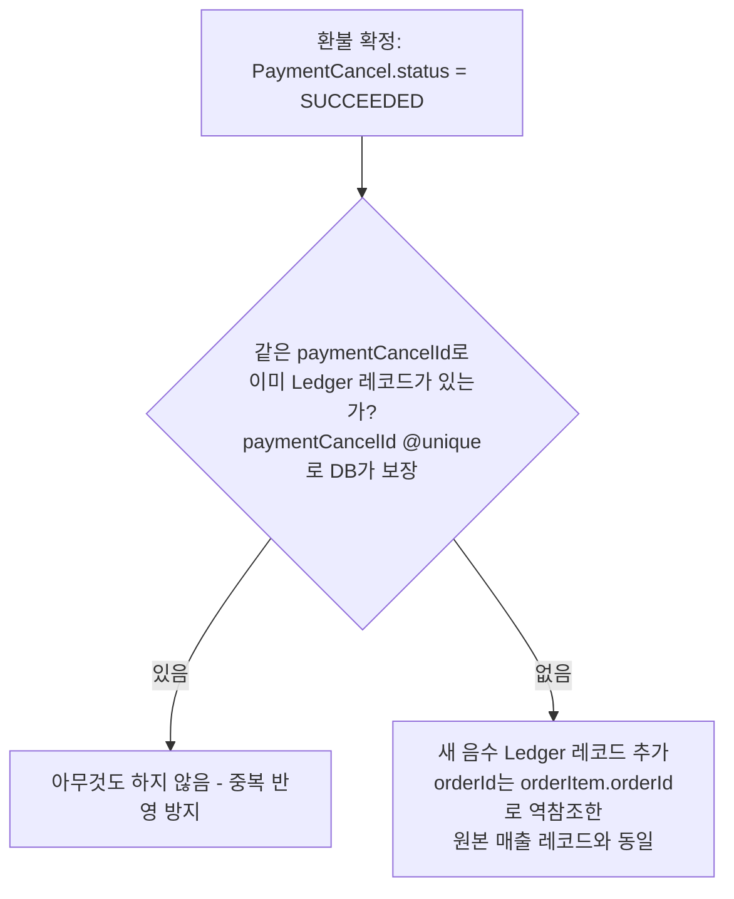

# 정산 정책 문서

이 문서는 매장에 매출을 지급하는 **정산(Ledger)** 자체의 설계를
다룬다 — append-only 원장 모델, 정산 배치와 조회의 분리, 배치
실행 이력 추적처럼 **환불이 없어도 성립하는 정산 시스템 고유의
아키텍처**가 범위다.

환불이 정산에 미치는 영향(환불 확정 시 어떤 신호를 보내는가, 언제
반영하는가)은 [환불_정책.md §5](./환불_정책.md#5-정산ledger-연동)가
다루고, 이 문서를 참조한다 — 두 문서의 역할은 "환불이 정산을
트리거하는 지점"(환불 정책)과 "정산 시스템 자체가 그 신호를 어떻게
처리하는가"(이 문서)로 나뉜다.

> **구현 상태 (2026-10-09 기준)**: 스키마 설계는 확정되어
> `prisma/schema.prisma`에 반영됐다(마이그레이션은 아직 생성 전).
> 서비스 로직(정산 배치 실행, 대시보드 조회 쿼리)은 미구현 —
> 현재 `src/ledger/`에는 `settle()`(단건 `RELEASABLE → SETTLED`
> 전이)과 매장 대시보드 조회만 있고, 이 문서가 정의하는 append-only
> 갱신·배치 추적 로직은 아직 없다.

---

## 1. 문제

`Ledger`는 매장 정산 단위(`sellerId`, `orderId`)로 존재하며 상태는
`HELD → RELEASABLE → SETTLED`로 전이한다(`prisma/schema.prisma`).
환불이 발생했을 때 이미 정산 단계에 들어간 매출을 어떻게 회수할지
정해야 한다.

> **[재검토, 2026-10-09] 기존 설계("환불 즉시 `Ledger.amount`를
> 차감")를 append-only 원장 모델로 교체했다.** 기존 설계는 "환불이
> 확정되는 즉시 Ledger에 실시간 반영해야 한다"는 전제에서 출발했는데,
> 재검토 결과 그 전제 자체가 불필요했다 — 아래 §2에서 설명.

## 2. 설계: 환불도 하나의 원장 레코드다

**핵심 아이디어는 "UPDATE 대신 INSERT"다.** 환불이 발생해도 기존
`Ledger` 레코드(매출 1건)를 수정하지 않는다. 대신 그 환불 자체를
**새로운 음수 `Ledger` 레코드**로 추가한다. 매출도, 환불도 모두 같은
테이블에 "거래 사실 1건 = 레코드 1건"으로 쌓이는 불변(append-only)
원장이 된다 — Stripe의 `Balance Transaction`이 같은 패턴을 쓴다.

```
정산 예정액(특정 Order) = SUM(Ledger.amount WHERE orderId = X AND status != SETTLED)
```

**`orderId`를 정산 단위로 쓰는 이유**: 결제(매출의 원천)는 `Order`
단위로 이루어지는 반면([환불_정책.md §0](./환불_정책.md#0-환불의-시작점--order-orderitem-ticket)
참고), 환불은 `OrderItem` 단위로 발생한다(`PaymentCancel.orderItemId`).
매출 레코드는 `Order` 전체 금액을 그대로 쓰면 되고, 환불 레코드는
`orderItem.orderId`로 소속 `Order`를 역참조해 같은 `orderId`에 담으면
된다 — 그러면 `SUM`이 "이 주문에 대해 최종 지급할 금액"을 정확히
계산해낸다.

**`status != SETTLED` 조건이 반드시 있어야 하는 이유**: 같은 주문
안에서도 레코드별로 정산 시점이 다를 수 있다 — 예를 들어 매출 레코드가
먼저 생겨 정산 배치로 `SETTLED`(지급 완료)된 뒤에, 그 주문의 상품 중
하나만 나중에 환불돼 새 음수 레코드가 추가되는 경우다. 이때 `status`
조건 없이 그 주문의 모든 레코드를 단순 합산하면, 이미 지급이 끝난
매출과 아직 반영 안 된 환불이 뒤섞여 의미 없는 숫자가 나온다(§4
참고 — 정산 배치는 SETTLED 여부로만 미마감 레코드를 가려낸다). 원본
매출(+)과 환불(-)이 같은 공식으로 자연스럽게 상계되는 건 **"아직
마감되지 않은 레코드"라는 공통 조건을 만족하는 것들 사이에서만**
성립한다. 그래서 "지금 얼마를 정산해야 하는가"는 **그 시점에 쌓인
미마감 레코드를 더하기만 하면** 항상 정확하게 나온다. 사전에 미리
깎아둔 숫자를 따로 관리할 필요가 없다.

**이 설계가 기존 설계(직접 차감)의 세 가지 문제를 구조적으로 해소한다:**

| 기존 설계(직접 차감)의 문제 | append-only에서의 결과 |
|---|---|
| `HELD`/`RELEASABLE` 차감의 중복 방어가 `PaymentCancel`의 단일 전이에만 의존 | **해소됨** — 환불 레코드 삽입 자체를 `paymentCancelId` 멱등키로 보호하면 된다(같은 환불에 대한 레코드가 이미 있는지만 확인). `Ledger`가 더 이상 "이미 반영했는지" 상태를 몰라도 되는 구조로 바뀐다 |
| `Ledger`만 봐서는 왜 금액이 줄었는지 알 수 없음(환불 이력 조회 공백) | **해소됨** — 환불 자체가 `Ledger` 레코드이므로, `Ledger`를 조회하는 것만으로 "언제 얼마가 매출로 잡혔고 언제 얼마가 환불됐는지"가 그대로 드러난다 |
| `SETTLED` 이후 환불을 위해 `CLAWBACK_PENDING`이라는 별도 상태·분기가 필요 | **해소되어 제거함** — 마감된 거래에 대한 환불도 그냥 "아직 마감되지 않은 새 음수 레코드"로 추가하면 된다. 다음 정산 배치가 돌 때 자연히 상계되므로 `CLAWBACK_PENDING`이 불필요해 `prisma/schema.prisma`에서 제거했다(§4 참고) |

## 3. 정산 "배치"와 "조회"를 분리한다

**실시간으로 `Ledger`를 미리 반영해야 할 이유는 없다.** 이 서비스에서
정산은 두 가지 서로 다른 요구가 섞여 있었는데, 둘을 분리하면 각각
단순해진다.

- **정산 배치(실제 지급)**: 특정 시점(일배치/주배치 등)에 "이 매장의
  이번 주기 미마감 레코드를 모두 모아 지급을 확정"하는 작업. 돈이
  실제로 나가는 단위이므로 한 번 마감되면(§4의 `SETTLED` 전이)
  되돌리지 않는다. 이 시점에만 "얼마를 지급할지" 확정이 필요하다.
- **정산 예정액 조회(대시보드)**: 점주/관리자가 화면을 열거나
  새로고침할 때마다 "지금 시점의 정산 예정액"을 보여줘야 하는 요구.
  이건 `Ledger` 레코드를 미리 깎아둘 이유가 되지 못한다 — 조회
  시점에 `SUM(Ledger.amount WHERE orderId = X AND status != SETTLED)`를
  계산하면 항상 정확한 값을 즉석에서 얻을 수 있고, 이 값은 사전에
  반영해둔 값보다 오히려 더 정확하다(계산 로직이 레코드로 박제되지
  않고 매번 최신 `Ledger` 레코드를 반영하므로).

즉 환불 확정 시점에 해야 할 일은 "Ledger를 실시간으로 갱신"하는 게
아니라 "환불 레코드 하나를 원장에 추가"하는 것뿐이다. 정산 배치가
돌 때, 그 시점까지 쌓인 레코드를 집계해서 지급을 확정한다.

## 4. 언제, 무엇을 추가하는가

환불이 `Ledger`에 영향을 주는 시점은 `PaymentCancel.status`가
`SUCCEEDED`로 확정되는 순간(PG가 취소를 확정한 시점) 하나뿐이다.
`REQUESTED`(PG 응답 대기) 상태에서는 아직 실제로 돈이 나간 게
아니므로 원장에 아무것도 추가하지 않는다. 이 트리거 지점에 대한
배경은 [환불_정책.md §5](./환불_정책.md#5-정산ledger-연동) 참고.



이 삽입은 [환불 동시 진행 방지 프로세스 §3](./환불_동시_진행_방지_프로세스.md#3-확정-처리)의
"확정 처리" 트랜잭션에 자연스럽게 추가된다 — `PaymentCancel` 상태
갱신, `RefundLock` 삭제, 신규 `Ledger` 레코드 삽입을 **같은
트랜잭션**으로 묶어야 세 상태가 서로 어긋나지 않는다.

## 5. 스키마 변경(완료) 및 남은 미결 사항

> **[구현 완료, 2026-10-09]** 아래 스키마 변경을 `prisma/schema.prisma`에
> 반영했다(마이그레이션은 아직 생성 전):
> - `Ledger.paymentCancelId`(nullable, `@unique` FK → `PaymentCancel`) 추가 —
>   매출 레코드는 `null`, 환불 레코드는 해당 `PaymentCancel.id`.
>   `@unique`가 "같은 환불에 대해 레코드를 두 번 추가하지 않는다"는
>   멱등성을 DB 레벨에서 보장한다.
> - `Ledger.tradeId`(String) → `Ledger.orderId`(FK → `Order`)로 전환 —
>   근거는 위 §2 참고. 인덱스도 `(tradeId, status)` → `(orderId, status)`로
>   변경.
> - `Ledger.settlementBatchId`(nullable FK → `SettlementBatch`) 추가,
>   `SettlementBatch` 모델 신설 — 배치 1회 실행의 시작/종료 시각, 상태
>   (`IN_PROGRESS`/`COMPLETED`/`FAILED`), 집계 요약(`totalAmount`,
>   `sellerCount`, `ledgerCount`)을 기록한다. `Ledger` row 개별로는
>   "무엇이 지급됐는지"만 알 수 있고 "언제, 얼마를, 어떤 배치가"
>   처리했는지는 알 수 없어서 별도 테이블로 분리했다.
> - `LedgerStatus.CLAWBACK_PENDING` 제거 — 코드/시드 어디서도 쓰이지
>   않아 안전하게 제거. 이유는 아래 설명 참고.

**`CLAWBACK_PENDING` 상태를 제거한 이유**: "이미 마감(`SETTLED`)된
거래에 나중에 환불이 발생하는 상황" 자체는 append-only로 바꿔도
여전히 일어난다 — 고객의 환불 신청 시점과 매장의 정산 마감 시점은
서로 독립적이라 막을 수 없다. 달라지는 건 그 상황에 대한 **시스템의
반응**뿐이다: 기존 설계는 이를 `CLAWBACK_PENDING`이라는 별도 상태로
표시해 특별 분기 처리가 필요했지만, 새 모델에서는 그냥 새 음수
레코드를 추가하는 것으로 끝나 특별 취급이 불필요해졌다. 다만 "이미
지급된 돈을 실제로 어떻게 회수할지"(다음 정산에서 자동 상계할지,
별도 청구할지)는 레코드 추가와 별개로 여전히 결정이 필요하다 —
아래 회수 미달 처리 방식과 함께 미결로 남는다. 점주에게 "마감 후
환불이 발생했다"는 사실을 별도로 알려야 할 운영 요구가 있다면,
상태 대신 알림/태그 같은 형태로 남을 수도 있다.

**남은 미결 사항:**

- 매장이 이미 회수 대상 금액보다 적은 잔여 정산액만 남은 경우(음수
  정산 예정액) 처리 방식 — 다음 정산 주기로 이월할지, 즉시 별도
  청구할지는 append-only 모델에서도 동일하게 미결이다.

## 6. 참고

- 스키마: `prisma/schema.prisma`의 `Ledger`, `SettlementBatch`,
  `LedgerStatus`, `SettlementBatchStatus`
- 환불이 정산에 미치는 영향: [환불_정책.md §5](./환불_정책.md#5-정산ledger-연동)
- 관련 코드: `src/ledger/command/ledger-command.service.ts`,
  `src/ledger/query/ledger-query.service.ts`
