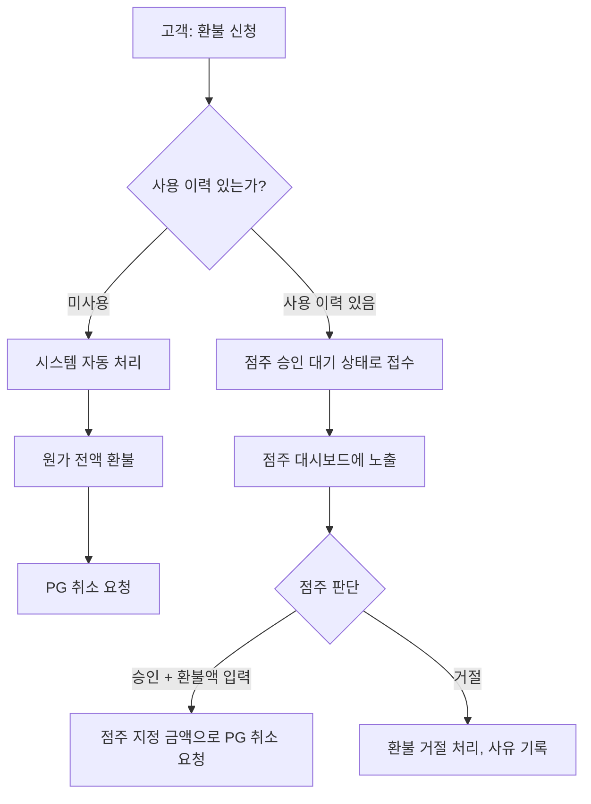
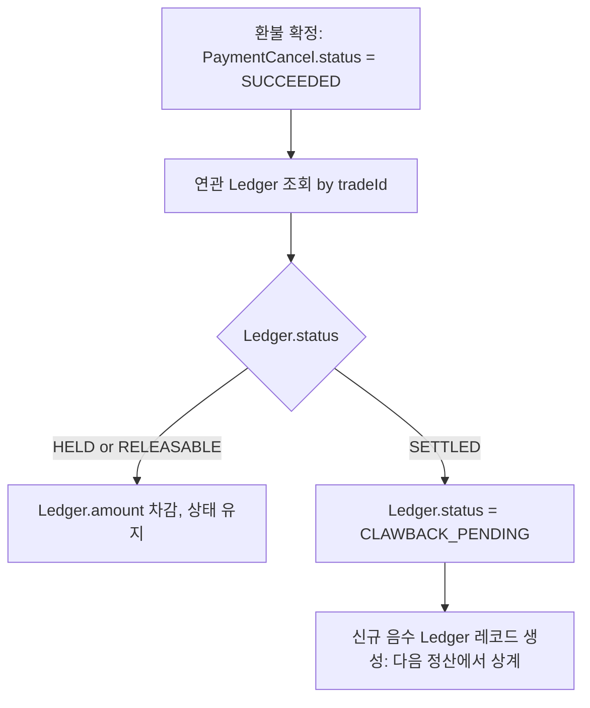
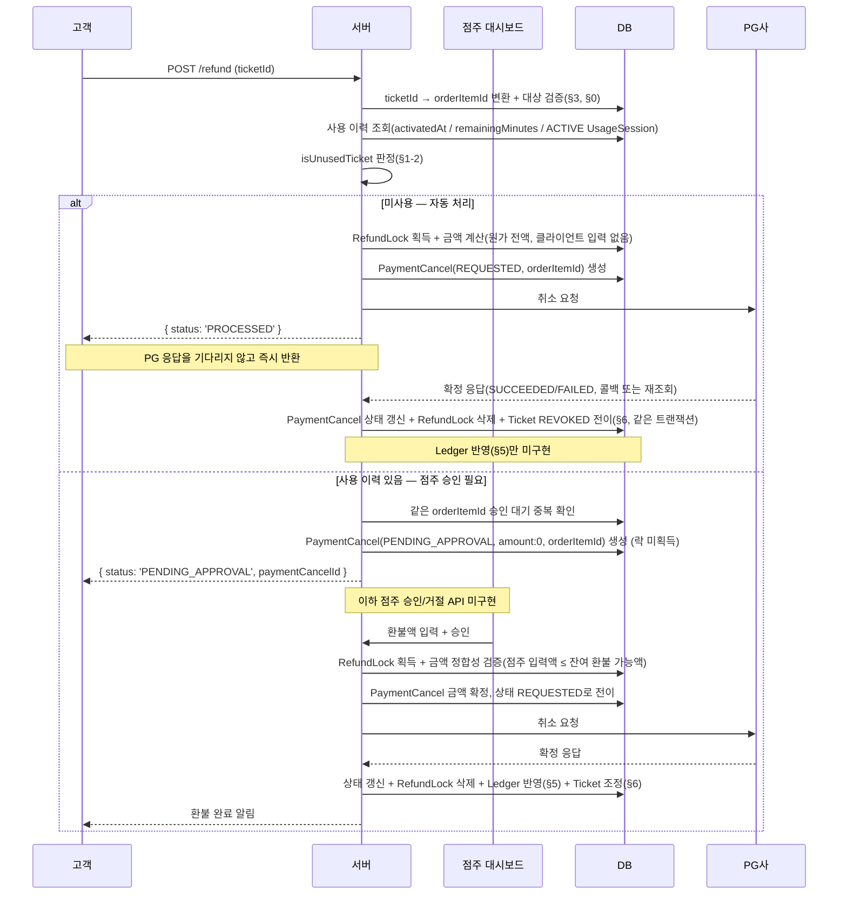

# 환불 프로세스 전체 설계

이 문서는 환불 요청부터 정산 반영까지 전체 흐름을 다룬다. 스키마 수준의
세부 설계는 아래 두 문서에 이미 정리되어 있으므로, 이 문서는 그 위에서
**정책(무엇을, 언제, 누가 결정하는가)**과 **end-to-end 흐름**을 다룬다.

핵심 스키마의 역할을 먼저 짚으면: **`PaymentCancel`은 "PG에 취소를
요청했다"는 실행 기록 1건**(PG 취소 API 호출 1회에 대응)이며,
`orderItemId` FK로 대상 상품(`OrderItem`)을 직접 참조한다. 한 번의
환불 신청은 항상 상품 1건을 대상으로 하므로([§0](#0-환불의-시작점--order-orderitem-ticket) 참고),
`PaymentCancel`과 `OrderItem`은 N:1 관계다(하나의 상품에 대해 취소
시도가 여러 번 있을 수 있으나, 하나의 취소는 항상 상품 1건만
대상으로 한다).

- [환불을 상품 단위로 추적하는 구조](./환불_상품단위_추적_구조.md) — `PaymentCancel`의 `orderItemId` 직접 참조 구조
- [환불 동시 진행 방지 프로세스](./환불_동시_진행_방지_프로세스.md) — `RefundLock`, 락 획득/해제, PG 재시도

> **구현 상태 (2026-09-05 기준)**:
> - **구현 완료**: §0(ticketId 단건 신청), §1(자동/수동 분기 로직 — `isUnusedTicket`),
>   §3의 일부(소유자/결제 상태 검증), §4(동시성 제어, 미사용 경로 한정)
> - **부분 구현**: §2(미사용 건 원가 전액 계산은 구현됨, 점주 승인 UI의 참고
>   환불액 제안은 미구현), §3(진행 중 `UsageSession` 검증은 "있으면 무조건
>   사용 이력 있음"으로 구현됨 — 신청 자체를 막는 것은 아님)
> - **미구현**: 점주 승인/거절 API 자체(§1-3, `PaymentCancel.status = PENDING_APPROVAL`
>   레코드만 생성하고 멈춤), §5(Ledger 연동), §6(Ticket 상태 반영 — 환불 성공
>   시 `Ticket`을 전혀 갱신하지 않음, 아래 §6 참고)
> - 관련 코드: `src/refund/refund.service.ts`, `refund.repository.ts`,
>   `refund.types.ts`, `dto/refund.dto.ts`

---

## 0. 환불의 시작점 — Order? OrderItem? Ticket?

환불을 어느 단위로 다루는지가 세 계층(`Order`, `OrderItem`, `Ticket`)에
걸쳐 있어 혼동하기 쉽다. 각 계층의 역할이 다르다.

| 계층 | 역할 | 이 문서에서의 위치 |
|---|---|---|
| `Order` | 결제 단위(한 번의 주문에 여러 상품이 담길 수 있음) | 환불 단위 아님 — [환불_상품단위_추적_구조.md](./환불_상품단위_추적_구조.md#왜-paymentcancel과-별개-모델로-나눴는가)가 이미 "환불은 상품 단위로 결정되지만 실행은 결제 단위"라고 정리함 |
| `OrderItem` | `PaymentCancel`/`RefundLock`의 물리적 키. 원가(`price`) 스냅샷을 들고 있어 **금액 정합성 검증의 기준 단위** | 서버 내부 처리 단위(§4의 락, 누적 금액 검증) |
| `Ticket` | 사용 이력 판정에 필요한 상태(`activatedAt`, `remainingMinutes`)를 들고 있고, `Ticket.orderItemId`가 unique라 `OrderItem`과 1:1. 고객이 화면에서 실제로 보고 고르는 대상("내 티켓 목록") | **환불 신청 API의 입력 단위** |

**신청 시 받는 식별자는 `ticketId`다.** 고객은 상품이 아니라 "내가 산
이용권"을 보고 환불을 요청하므로, API 표면은 `ticketId`를 받는 것이
자연스럽다. 서버는 요청을 받는 즉시 `Ticket.orderItemId`(unique)로 대상
`OrderItem`을 확정하고, 이후 §3~§7의 모든 처리(락 획득, 금액 검증,
`PaymentCancel` 생성)는 그 `orderItemId`를 기준으로 진행한다. 즉
`ticketId → orderItemId` 변환은 API 진입 시점에 한 번만 일어나는 얇은
계층이고, 그 아래 스키마·동시성 설계는 기존 두 문서가 정한
`OrderItem` 기준을 그대로 따른다.

**한 번의 신청은 티켓 1개만 대상으로 한다.** 한 주문에 정기권+시간권처럼
서로 다른 상품이 섞여 있으면, 상품마다 승인 분기(§1)와 사용 이력
판정 기준이 다를 수 있다. 여러 티켓을 한 요청에 묶으면 "일부는 자동
승인, 일부는 점주 승인 대기"처럼 응답이 갈리는 케이스를 API 레벨에서
따로 설계해야 한다. 여러 상품을 동시에 환불하고 싶으면 클라이언트가
`ticketId`별로 여러 번 요청한다 — 서버 내부적으로는 각 요청이 독립된
트랜잭션이므로 문제없이 병렬 처리된다. (기존 문서의 "다건 전체 취소"
시나리오는 이 방식이 여러 번 반복된 결과로 자연스럽게 커버된다. PG
취소 자체를 한 번의 API 호출로 묶어 여러 상품을 동시에 취소하는
케이스는 이 프로젝트에서 다루지 않는다.)

---

## 1. 환불 신청·승인 모델

### 1-1. 왜 자동/수동 하이브리드인가

환불 승인 모델은 크게 세 갈래로 나뉜다.

| 모델 | 특징 | 이 프로젝트 채택 여부 |   
|---|---|---|
| 완전 자동(고객 요청 즉시 처리) | 빠르지만 오남용·과다 환불 위험 관리가 어려움 | 미사용 건에 한해 채택 |
| 완전 수동(모든 건 점주 승인) | 안전하지만 미사용 단순 취소까지 점주를 기다리게 해 UX 저하 | 미채택 |
| 하이브리드(조건부 자동 + 조건부 수동) | 판단이 기계적인 건은 자동, 재량이 필요한 건만 사람에게 | **채택** |

이 프로젝트는 PC방/스터디카페 좌석 예약 서비스로, 정기권/시간권을
**전혀 쓰지 않은 상태의 취소**는 환불액 산정에 재량이 개입할 여지가 없다
(원가 그대로 돌려주면 된다). 반면 **일부라도 사용한 뒤의 취소**는 원가
산정에 PG/가맹점 수수료, 사용 기간 산정 방식 등 매장 운영 정책이 개입할
여지가 있다. 이 둘을 같은 절차로 묶으면 단순 건까지 점주 대기가
필요해지거나, 반대로 재량이 필요한 건까지 기계적으로 처리하는 문제가
생긴다. 그래서 **판단 기준을 "사용 이력 유무"로 나눠 분기**한다.

### 1-2. 분기 기준

| 상품 | 미사용 판정 기준 |
|---|---|
| 정기권(`PERIOD`) | `Ticket.activatedAt IS NULL` (아직 활성화 전) |
| 시간권(`TIME`) | `Ticket.remainingMinutes = Ticket.purchasedMinutes` (한 번도 소진 안 됨) |
| 공통(우선 검사) | 진행 중인 `UsageSession`(status = `ACTIVE`)이 있으면 위 조건과 무관하게 무조건 사용 이력 있음으로 판정 |

> **구현 세부사항**: `Ticket.remainingMinutes`는 `UsageSession`이 **종료**되는
> 시점에만 차감되는 사후 정산 방식이라(`usage-session.repository.ts`의
> `endUsageSession()`), 지금 이용 중인 세션이 있어도 `remainingMinutes`가
> 아직 구매 시점 값 그대로일 수 있다. 이 상태를 `remainingMinutes` 비교만으로
> "미사용"으로 잘못 판정하는 걸 막기 위해, ACTIVE 세션 존재 여부를 최우선으로
> 검사한다(`RefundService.isUnusedTicket()`, `RefundRepository.getTicketById()`가
> `usageSessions`를 `status: ACTIVE`로 필터링해 함께 조회).

### 1-3. 신청/승인 주체와 채널

- **고객**: 환불 신청 API(`POST /refund`)로 직접 신청한다. 요청 본문은
  `ticketId` 하나뿐이다([§0](#0-환불의-시작점--order-orderitem-ticket) 참고,
  `RefundDto`에 `refundAmount` 필드 없음 — 고객은 금액을 지정할 권한이 없다).
  서버가 이를 `orderItemId`로 변환해 이후 처리를 진행한다.
- **미사용 건**: 신청과 동시에 시스템이 [§2](#2-환불-금액-산정)의 규칙대로
  전액 환불을 자동 확정하고, 곧바로 [§4](#4-동시성-제어)의 락 획득 →
  PG 취소 흐름으로 들어간다. 점주 개입 없음. (`RefundService.refund()`가
  `{ status: 'PROCESSED' }`를 반환)
- **사용 이력 있는 건**: 신청 시점에는 금액을 확정하지 않고
  `PaymentCancel`(status: `PENDING_APPROVAL`, `amount: 0`, `orderItemId` 연결)만 생성하고 멈춘다
  (`{ status: 'PENDING_APPROVAL', paymentCancelId }` 반환). **점주 승인/거절
  API 자체는 아직 구현되지 않았다** — 이 상태에서 더 진행되는 로직이 없다.
  구현되면 점주가 대시보드에서 건을 확인하고 **환불액을 직접 입력해 승인**하거나
  거절하는 흐름이 될 것이다. 이 금액은 시스템이 자동 계산하지 않는다 — 사용
  기간에 따른 원가 산정(PG 수수료, 가맹점 수수료 등)은 매장 운영 정책의
  재량 영역으로 남겨둔다.
- **승인 대기 중 중복 신청 방지**: 같은 `orderItemId`로 이미 `PENDING_APPROVAL`
  상태의 `PaymentCancel`이 있으면 새 신청을 `DomainConflictError`(409)로
  거부한다(`RefundRepository.createPendingApprovalPaymentCancel` 내부에서
  같은 트랜잭션으로 확인+생성). §4에서 "확인 필요"로 남겼던 지점이 이 방식으로
  해결됨.

> **왜 사용 이력 건의 환불액을 시스템이 계산하지 않는가**: 계속적 용역
> 계약의 중도 해지 시 "미사용분을 사용 기간에 비례해 환불"하는 것이
> 국내 소비자 보호 관행상 일반적인 원칙이지만, 정확한 공제 항목(PG
> 수수료, 위약금 비율 등)은 매장·업종마다 다르고 법적으로 세밀한 검토가
> 필요한 영역이다. 시스템이 임의로 계산식을 강제하면 오히려 매장별
> 정책 차이를 반영하지 못하거나 법적 리스크를 시스템이 떠안게 된다.
> 그래서 "미사용 → 원가 그대로"라는 다툼의 여지가 없는 케이스만
> 자동화하고, 나머지는 점주 재량 + 기록(감사 추적)으로 처리한다.
> **미구현·확인 필요**: 점주가 입력하는 환불액에 대한 상한 검증
> (예: 원가 초과 입력 방지)은 최소한의 안전장치로 필요하다. 하한 없음
> (0원 승인 = 사실상 거절)도 허용할지는 정책 확인이 필요하다.

---

## 2. 환불 금액 산정 (미사용 건 자동 계산)

미사용 건은 **일할 계산 없이 원가 전액**을 환불한다. 애초에 사용을
시작하지 않았으므로 일할 계산 자체가 적용될 여지가 없다.

> 최초 논의 단계에서는 "일할 계산(사용일수 비례 차감)"을 정기권/시간권
> 공통 원칙으로 검토했으나, 실제로 일할 계산이 필요한 케이스(사용 이력
> 있는 부분 환불)는 [§1](#1-환불-신청승인-모델)의 분기에 따라 점주
> 재량으로 넘어갔다. 따라서 시스템이 자동으로 실행하는 일할 계산 로직은
> 현재 정책상 없다 — 아래는 **향후 점주 승인 UI가 참고 금액(제안값)을
> 보여주고 싶을 때 쓸 수 있는 참고 공식**으로 남겨둔다.

| 상품 | 참고 공식(점주 승인 UI의 제안값 후보) | 기준일 |
|---|---|---|
| 정기권 | `원가 × (1 - 경과일수 / purchasedDurationDays)` | 경과일수 = `환불신청일 - activatedAt` |
| 시간권 | `원가 × (remainingMinutes / purchasedMinutes)` | 신청 시점의 `remainingMinutes` (진행 중인 `UsageSession`이 있으면 먼저 종료 처리 후 확정된 값 사용) |

**확인 필요**: 점주 승인 UI에 이 참고값을 보여줄지, 아니면 완전 백지
입력으로 둘지는 아직 결정되지 않았다. 참고값을 보여주기로 하면
`OrderItem.price`, `Ticket.purchasedDurationDays`/`activatedAt` 또는
`purchasedMinutes`/`remainingMinutes`를 조회하는 별도 쿼리 서비스가
필요하다.

---

## 3. 환불 대상 검증

환불 신청이 들어오면 금액 계산·승인 분기 이전에 아래 조건을 먼저
검증해야 한다 (기존 두 문서에 없는, 신청 접수 단계의 선행 검증).

- `Ticket`이 해당 요청자의 소유인가 (`Ticket.userId` 확인 — `ticketId`를
  받는 시점에 가장 먼저 검증, [§0](#0-환불의-시작점--order-orderitem-ticket) 참고) **[구현됨]**
- 해당 `Payment`가 `SUCCESS` 상태인가 (결제 완료되지 않은 건은 환불 대상이
  아니라 결제 취소/재시도 대상) **[구현됨]**
- 이미 전액 환불된 상품인가 — 미사용 자동 처리 경로에서는 `createRefundWithLock`이
  `calculateRefundableAmount`의 `refund_amount > refundable_amount` 비교로
  차단한다 **[구현됨, 다만 §6과 연결된 구조적 한계 있음 — 아래 §6 참고]**.
  사용 이력 있는 건(점주 승인 경로)에서는 아직 검증 지점 자체가 없음(승인
  API 미구현).
- 진행 중인 `UsageSession`(현재 좌석 이용 중)이 있는가 — **[구현됨, 다만
  "신청 자체를 막는" 방식이 아니라 "자동/수동 분기에 반영하는" 방식으로
  구현됨]**. 애초에 우려했던 "자동 승인 대상에는 사용 이력이 없어야
  하므로 문제되지 않는다"는 전제가 실제로는 성립하지 않는 것으로
  확인되어([§1-2](#1-2-분기-기준) 참고, `remainingMinutes`가 세션 종료 시에만
  차감되는 사후 정산 방식이라 진행 중 세션이 있어도 "미사용"으로 오판될 수
  있었음), ACTIVE 세션이 있으면 `remainingMinutes`/`activatedAt` 값과
  무관하게 무조건 "사용 이력 있음"(점주 승인 대상)으로 분류하도록
  `isUnusedTicket()`에 반영했다. "이용 중에 환불 요청 → 점주가 승인하는
  동안 계속 이용"하는 애매한 상태 자체는 여전히 남아있다 — 점주 승인 API
  구현 시 재검토 필요.

---

## 4. 동시성 제어

락 획득, 금액 정합성 검증, PG 재시도, TTL 자가 치유의 상세 메커니즘은
[환불 동시 진행 방지 프로세스](./환불_동시_진행_방지_프로세스.md)를 그대로
따른다. 이 문서에서 추가되는 것은 **승인 분기가 락 획득 시점에 어떤
영향을 주는가** 뿐이다.

- **미사용 자동 처리 [구현됨]**: 신청 즉시 같은 요청 안에서 락 획득 → 금액 계산
  (원가 전액, 클라이언트 입력 없음) → `PaymentCancel` 생성 →
  PG 호출까지 이어진다. 상세 흐름은 [환불_처리_시퀀스.md](../환불_처리_시퀀스.md) 참고.
- **점주 승인 대상 [부분 구현됨]**: 신청 시점에는 **락을 걸지 않는다.** 승인 대기
  상태는 "아직 실행이 결정되지 않은 요청"이므로, 이 시점에 `RefundLock`을
  잡으면 점주가 승인/거절을 미루는 동안 다른 정당한 환불 시도(예: 같은
  주문의 다른 상품)를 막을 이유가 없다. 락은 **점주가 승인해 실제 PG
  취소를 실행하는 시점**에 획득할 예정이나, 그 승인 API 자체가 아직
  구현되지 않아 이 부분은 미완성이다. 승인 대기 중 같은 `orderItemId`에
  대한 중복 신청 방지는 **구현 완료** — `PaymentCancel`에 별도 제약을
  추가하지 않고, `createPendingApprovalPaymentCancel`이 같은 트랜잭션
  안에서 "이 `orderItemId`로 `PENDING_APPROVAL` 상태가 이미 있는가"를
  확인한 뒤 있으면 `DomainConflictError`(409)로 거부하는 애플리케이션
  레벨 검사로 해결했다.

---

## 5. 정산(Ledger) 연동

### 5-1. 문제

`Ledger`는 매장 정산 단위(`sellerId`, `tradeId`)로 존재하며 상태는
`HELD → RELEASABLE → SETTLED`로 전이한다(`prisma/schema.prisma`).
`CLAWBACK_PENDING`이 이미 enum에 정의되어 있지만, 이를 트리거하는 로직은
없다. 환불이 발생했을 때 이미 정산 단계에 들어간 매출을 어떻게 회수할지
정해야 한다.

### 5-2. Ledger 상태별 환불 처리

환불 시점에 해당 매출(`tradeId`로 연결된 `Ledger`)이 어느 상태인지에
따라 처리가 갈린다.

| Ledger 상태 | 의미 | 환불 발생 시 처리 |
|---|---|---|
| `HELD` | 아직 매장에 지급 보류 중 | 정산 대상 금액에서 환불액을 **차감하고 상태 유지**(`HELD`). 아직 지급되지 않았으므로 회수할 필요 없이 지급될 금액 자체를 줄인다. |
| `RELEASABLE` | 지급 가능(정산 대기) | 마찬가지로 환불액만큼 차감. 아직 `SETTLED`가 아니므로 `HELD`와 동일하게 처리 가능. |
| `SETTLED` | 이미 매장에 지급 완료 | 이미 지급된 돈이므로 이 `Ledger` 레코드 자체를 되돌릴 수 없다. 상태를 `CLAWBACK_PENDING`으로 전이시키고, **별도의 음수 조정 항목(차감 정산 건)**을 만들어 다음 정산 주기에서 상계한다. |

**왜 `SETTLED` 건을 직접 고치지 않는가**: `SETTLED`는 이미 매장에 실제
자금이 이체된 사실의 기록이다. 과거 사실을 소급 수정하면 회계 추적성이
깨진다. 대신 "이미 지급된 돈 중 일부를 다음 정산에서 회수해야 한다"는
새로운 사실을 별도 레코드로 남기는 쪽이, 정산 내역을 감사할 때 "언제
얼마가 지급됐고 언제 얼마가 회수됐는지"를 그대로 보여줄 수 있다.

**확인 필요**:
- 음수 조정 항목을 `Ledger` 테이블에 그대로 넣을지(같은 스키마, `amount`가
  음수인 레코드), 아니면 `LedgerAdjustment` 같은 별도 모델로 분리할지.
  후자는 "정산"과 "조정"의 원인이 다르므로 구분해서 조회하고 싶다는
  요구가 생기면 유리하지만, 지금은 `Ledger` 자체도 매우 단순한 스키마라
  섣부른 분리는 과설계가 될 수 있다.
- `CLAWBACK_PENDING`에서 회수가 완료되면 어떤 상태로 전이하는지(`SETTLED`로
  복귀? 별도 종결 상태?) 정의되어 있지 않다.
- 매장이 이미 회수 대상 금액보다 적은 잔여 정산액만 남은 경우(마이너스
  정산) 처리 방식 — 다음 정산 주기로 이월할지, 즉시 별도 청구할지.

### 5-3. 언제 Ledger에 반영하는가

환불 자체는 `PaymentCancel.status`가 `SUCCEEDED`로 확정되는 시점(PG가
취소를 확정한 시점)에만 Ledger에 반영한다. `REQUESTED`(PG 응답 대기)
상태에서는 아직 실제로 돈이 나간 게 아니므로 Ledger를 건드리지 않는다.
이는 [환불 동시 진행 방지 프로세스 §3](./환불_동시_진행_방지_프로세스.md#3-확정-처리)의
"확정 처리" 트랜잭션에 Ledger 갱신을 추가하는 것으로 자연스럽게 확장된다
— PaymentCancel 상태 갱신, RefundLock 삭제, Ledger 조정을 **같은
트랜잭션**으로 묶어야 세 상태가 서로 어긋나지 않는다.

---

## 6. 티켓 상태 반영

> **✅ 미사용 자동 처리 경로 해결됨(2026-09-06)**: "이용 중인 이용권의 환불은
> 항상 그 시점에 이용권을 종료시키면서 잔여 가치를 전액 돌려주는 것"이라는
> 재정의(아래 참고)에 따라, 하나의 `OrderItem`에 대한 환불은 원칙적으로 딱
> 한 번만 일어나야 한다는 결론을 코드에 반영했다. `RefundService.callback()`
> 성공 분기와 `clearStaleLock()`의 `SUCCEEDED` 확정 분기 모두, PG 확정
> (`succeedPaymentCancel`)과 같은 트랜잭션 안에서
> `RefundRepository.revokeTicket()`을 호출해 `Ticket.status`를 `REVOKED`로
> 전이시킨다. `refund()` 진입 시에도 `getTicketById`가 `status`를 함께
> 조회해 이미 `REVOKED`인 티켓은 락 획득 전에 즉시 거부한다.
> `calculateRefundableAmount`도 "원가 - 누적 취소액"이 아니라 "이미
> `SUCCEEDED`된 이력이 있는지(`already_refunded`)"만 확인하도록 단순화되어,
> 이 검증이 이제는 우연이 아니라 명시적 방어로 남아있다(REVOKED 검증과
> 이중 방어).
>
> **남은 범위(미사용 자동 처리 경로 밖)**: 점주 승인 경로
> (`PaymentCancelStatus.PENDING_APPROVAL`)는 이 해결에 포함되지 않는다.
> 승인/거절 API 자체가 아직 없고, 승인 대기 중인 `Ticket`을 어떻게
> 처리할지(신규 상태 신설 후 거절 시 원복 여부, 심사 기간만큼 유효기간
> 보정 필요 여부)는 `TicketPause`의 미구현 보정 로직과 얽혀 있어 범위가
> 크다 — `docs/TODO.md`의 8번 항목으로 별도 분리되어 있다.

환불이 확정되면 해당 `Ticket`도 더 이상 유효하지 않은 상태로 전이해야
한다. 미사용 자동 처리 경로는 위와 같이 해결됐고, `TicketStatus.REVOKED`를
그대로 재사용한다(별도 상태 신설 없이 확정).

**여전히 확인 필요 (점주 승인 경로)**:
- 승인 대기(`PENDING_APPROVAL`) 상태인 동안 `Ticket`을 어떻게 처리할지 —
  새 상태를 신설해 이용 자체를 막고 거절 시 원복할지, 승인 확정 시에만
  `REVOKED`로 전이시킬지.
- 신규 상태를 만든다면, 심사 기간만큼 유효기간(만료일)을 보정해야 하는가
  — `TicketPause`가 이미 "정지 기간만큼 연장"이라는 동일한 문제를 다루도록
  설계되어 있으나 실제 구현(`pauseTicket`/`resumeTicket`)이 없다.

> **부분 환불 모델 재정의 반영 완료(2026-09-06)**: 2026-09-05에 재검토했던
> "이용 중인 이용권의 환불은 항상 그 시점에 이용권을 종료시키면서 잔여
> 가치를 계산해 전액 돌려주는 것"이며 "일부만 환불받고 나머지는 계속
> 보유"하는 중간 단계는 존재하지 않는다는 결론을, `calculateRefundableAmount`
> 재작성으로 반영했다(위 "미사용 자동 처리 경로 해결됨" 참고). 다만 이
> 재정의가 실제로 검증되는 건 지금까지 `SUCCEEDED`에 도달할 수 있는 유일한
> 경로가 미사용 자동 처리뿐이기 때문이다 — 점주 승인 API가 구현되어 그
> 경로도 `SUCCEEDED`에 도달하게 되면, 같은 원칙(환불 1회, 즉시 `REVOKED`)이
> 그 경로에도 적용되는지 재확인해야 한다.
> [환불_상품단위_추적_구조.md](./환불_상품단위_추적_구조.md)와
> [환불_처리_시퀀스.md](../환불_처리_시퀀스.md)도 함께 갱신됨.

---

## 7. 전체 흐름 요약

> 아래는 실제 구현 순서를 반영한다(사용 이력 분기가 락 관련 로직보다 먼저
> 일어남 — [§4](#4-동시성-제어) 참고). Ledger 반영은 여전히 미구현이다.
> Ticket 무효화는 미사용 자동 처리 경로에서 해결됐다(§6 참고). 상세 시퀀스는
> [환불_처리_시퀀스.md](../환불_처리_시퀀스.md) 참고.

---

## 8. 미결 정책 정리

이 문서를 작성하며 확인이 필요하다고 표시한 항목을 한 곳에 모은다.
결정되는 대로 각 섹션과 [TODO.md](../TODO.md)에 반영한다.

1. 점주 승인 UI에서 참고 환불액(일할 계산값)을 제안할지 여부 ([§2](#2-환불-금액-산정))
2. 점주 입력 환불액의 상한/하한 검증 규칙 ([§1-3](#1-3-신청승인-주체와-채널))
3. 이용 중(`UsageSession` ACTIVE)인 티켓의 환불 신청을 아예 막을지 여부 —
   지금은 신청 자체는 허용하되 자동/수동 분기에서 "사용 이력 있음"으로
   처리한다([§3](#3-환불-대상-검증))
4. ~~승인 대기 상태에서 같은 상품 중복 신청 방지 방식~~ — **해결됨**:
   애플리케이션 레벨 트랜잭션 검사로 구현 완료([§4](#4-동시성-제어))
5. 정산 조정 항목을 `Ledger`에 통합할지 별도 모델로 분리할지 ([§5-2](#5-2-ledger-상태별-환불-처리))
6. `CLAWBACK_PENDING`의 종결 상태 및 회수 미달(마이너스 정산) 처리 방식 ([§5-2](#5-2-ledger-상태별-환불-처리))
7. ~~환불 확정 시 `Ticket` 상태 전이 규칙~~ — **미사용 자동 처리 경로
   해결됨(2026-09-06)**: `revokeTicket()`으로 `REVOKED` 전이 구현
   완료([§6](#6-티켓-상태-반영))
8. ~~하나의 `OrderItem`에 대해 환불이 여러 번(부분) 발생할 수 있는 현재
   설계를 재설계할지~~ — **미사용 자동 처리 경로 해결됨(2026-09-06)**:
   `calculateRefundableAmount`를 "이미 SUCCEEDED 이력 존재 여부" 확인으로
   단순화([§6](#6-티켓-상태-반영), [환불_상품단위_추적_구조.md](./환불_상품단위_추적_구조.md)와도 연결됨)
9. **[신규, 2026-09-06]** 점주 승인 경로(`PENDING_APPROVAL`)의 `Ticket`
   상태 처리 및 `TicketPause` 만료일 보정 로직 — 심사 중 상태 신설 여부,
   신설 시 거절 후 유효기간 복원 방식. `docs/TODO.md`의 8번 항목 참고.

## 9. 참고

- 스키마: `prisma/schema.prisma`의 `PaymentCancel`, `RefundLock`, `Ledger`,
  `Ticket`
- 관련 설계: [환불_상품단위_추적_구조.md](./환불_상품단위_추적_구조.md),
  [환불_동시_진행_방지_프로세스.md](./환불_동시_진행_방지_프로세스.md)
- 미구현 항목 추적: [TODO.md](../TODO.md)
